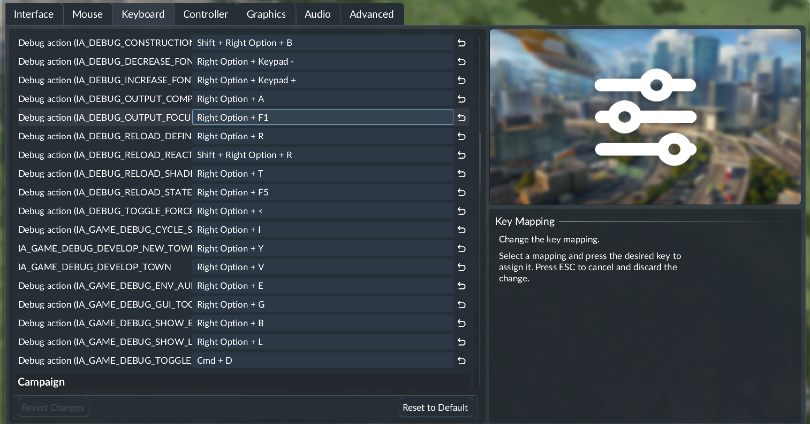

# Debug Keybindings

A Transport Fever 3 mod that makes the debug actions rebindable in the key binding settings.

## Installation

- **mod.io:** subscribe in the in-game mod browser.
- **Local:** copy `src/debug_keybindings` to the mod directory of the game and enable the mod.
